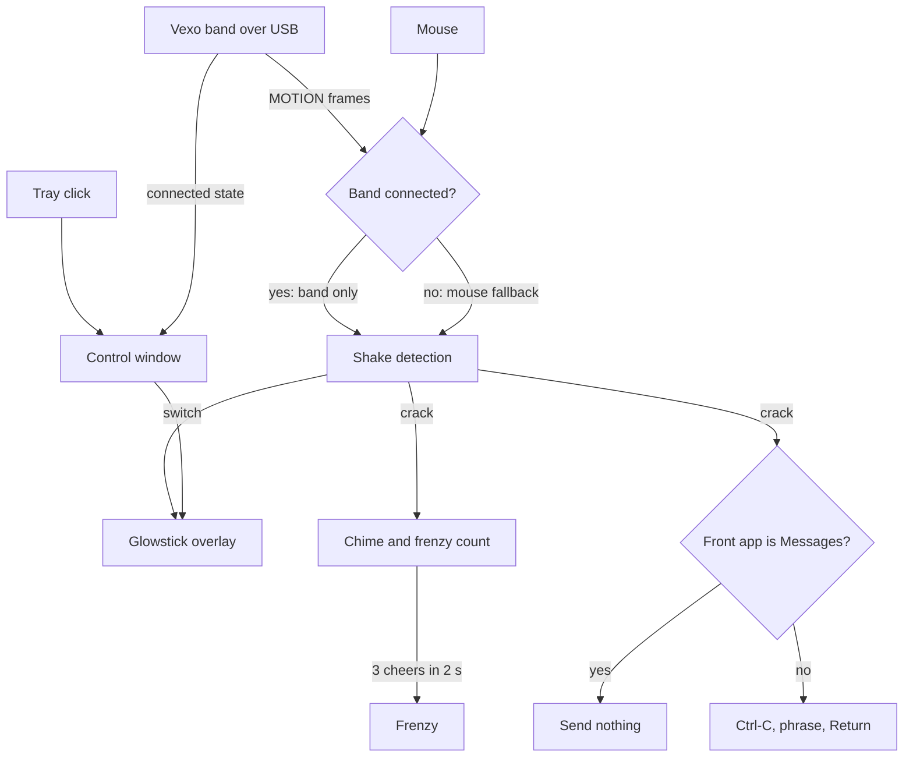

# openCheer


Sometimes claude code is going too shlow, and you must cheer him on.. with glowsticks!

## Install + run

```bash
npm install -g opencheer
opencheer
```

windows and mac supported out of the box, but Linux is a special snowflake so you need to install `xdotool` for keyboard automation

```bash
sudo apt install xdotool
```

## Controls

- Click tray icon: open the control window. Use its switch to show or drop the glowsticks and see if the band is connected.
- Cheer him on 🎉
- It sends an interrupt (Ctrl-C) and one of 5 encouraging messages!

## How it works



## Variables

No environment variable is read. Edit the values in the files below.

`overlay.html`, object `P` (px, radians, ms):

| Name | Default | What it does |
|---|---|---|
| `stickLength` | 300 | Stick length (px) |
| `stickWidth` | 26 | Stick width (px) |
| `edgeMargin` | 100 | Distance of the first stick from the screen edge (px) |
| `stickSpacing` | 110 | X gap between sticks on one edge (px) |
| `waveAmp` | 0.2 | Idle wave size (rad) |
| `waveSpeed` | 0.0022 | Idle wave speed (rad/ms) |
| `leanByMouseX` | 0.012 | Lean per px of mouse speed (rad) |
| `leanClamp` | 0.7 | Maximum mouse lean (rad) |
| `leanSmooth` | 0.15 | Mouse lean smoothing |
| `bandRollAxes` | `['ax','az']` | Gravity axes used for the band roll; swap them if the sticks lean the wrong way |
| `bandRollSign` | 1 | Set -1 to mirror the lean |
| `bandRollClamp` | 1.2 | Maximum band roll (rad) |
| `bandSmooth` | 0.2 | Band roll smoothing |
| `bandWaveAmp` | 0.04 | Idle wave size while the band is live (rad) |
| `bandShakeDps` | 400 | Wrist gyro speed that counts as a shake (deg/s) |
| `bandLiveMs` | 3000 | Band is live while its last sample is younger than this (ms) |
| `crackSpeed` | 60 | Mouse speed that counts as a crack (px/frame) |
| `crackCooldownMs` | 200 | Minimum time between cracks (ms) |
| `firstCrackGraceMs` | 350 | No crack for this long after the sticks appear (ms) |
| `fallMs` | 600 | Drop animation time (ms) |
| `frenzyCheers` | 3 | Cheers in the window that start frenzy |
| `frenzyWindowMs` | 2000 | Frenzy counting window (ms) |
| `frenzyMs` | 4000 | Frenzy length (ms) |

Sound: the chime, swoosh and fanfare notes are fixed in `overlay.html` (functions `playChime`, `playSwoosh`, `playFanfare`); they have no settings.

`band.js`:

| Name | Default | What it does |
|---|---|---|
| `SILENT_MS` | 3000 | No MOTION frame for this long: not connected, STREAM_START is sent again (ms) |
| `RETRY_MS` | 3000 | Wait between searches for the port (ms) |
| `tickMs` (`REAL_IO`) | 1000 | Check interval (ms) |
| USB product name | `Vexo Open band` | Port match in `findPort` (macOS `ioreg`; device `/dev/cu.usbmodem*`) |

`main.js`:

| Name | Default | What it does |
|---|---|---|
| `phrases` (in `sendMacro`) | 6 cheers, e.g. "You got this!" | Texts typed on a cheer; one is chosen at random |
| `delayMs` (`refocusPreviousApp`) | 80 | Wait before focus returns to the previous app (ms) |
| Macro delay (`sendMacroMacUnchecked`) | 300 | macOS: wait between Ctrl-C and the typed phrase (ms) |
| Skipped app (`ifNotMessages`) | `Messages` | macOS: no cheer is sent when this app is in front |

## Roadmap

- [x] Initial release! 🥳
- [x] Cease and desist letter from Anthropic
- [ ] Crypto miner
- [ ] Logs of how many times you whipped claude so when the robots come we can order people nicely for them
- [ ] Updated whip physics

## Ecosystem

The OFFICAL opencheer ecosystem token. 

Contract address: BRyUZbJkm9Pty4FUmTrBGno7U4Ga8TWzcKJJRLCBpump

Stay tuned for updates on X! 👀
https://x.com/blended_jpeg