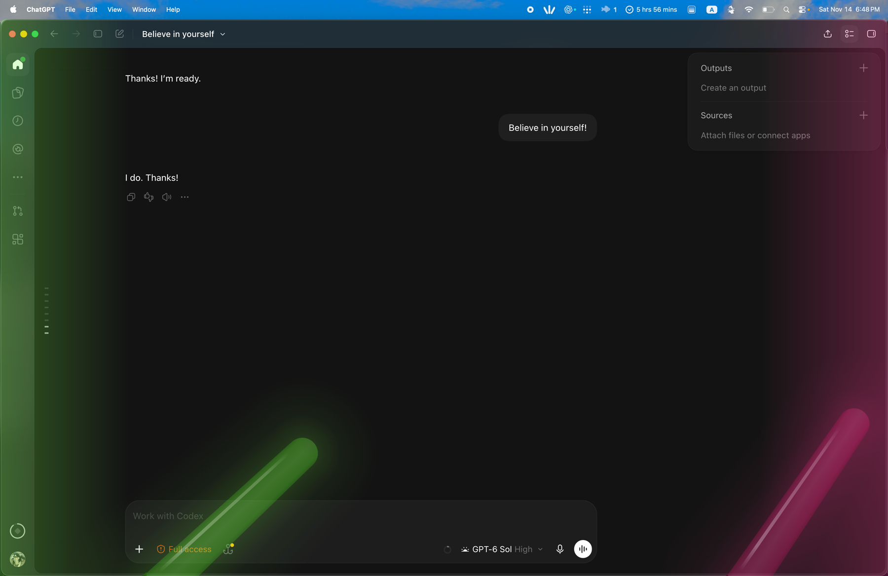
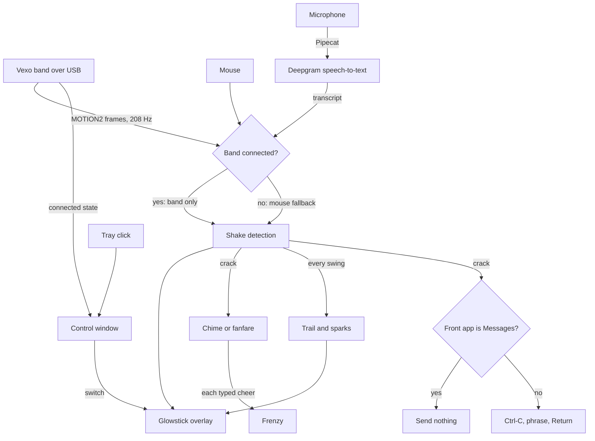

# openCheer



Sometimes claude code is going too shlow, and you must cheer him on.. with glowsticks!

The overlay shows two 3D glowsticks, one for each hand, in a first-person view from the bottom of the screen.

## Install + run

```bash
npm install -g opencheer
opencheer
```

windows and mac supported out of the box, but Linux is a special snowflake so you need to install `xdotool` for keyboard automation

```bash
sudo apt install xdotool
```

## Controls

- Click tray icon: open the control window. Use its switches to show or drop the glowsticks, turn the floating sparkle dots on or off (default off), choose with the Say my words switch whether your voice is typed live (and a shake presses Return) or a cheer types a preset phrase, and see if the band is connected.
- Cheer him on 🎉
- It sends an interrupt (Ctrl-C) and one of 6 encouraging messages, then Return. With Say my words on it instead types the words you say as you say them, and a shake only presses Return.

## How we use Deepgram

openCheer sends the microphone through a Pipecat pipeline in `voice/voice.py` to Deepgram streaming speech-to-text. The sidecar prints `SAY <text>` for each final transcript, and openCheer types those words at once (see below). If the sidecar exits, openCheer logs its exit code and starts it again after 2 s. It also prints `LEVEL <0..1>` (microphone loudness, about 15 times a second); the louder you are, the more each glowstick fills with light.

## Voice

On macOS the first start shows the microphone prompt for Electron. Start Electron as its own app, not from a terminal: `open -n /path/to/openCheer/node_modules/electron/dist/Electron.app --args /path/to/openCheer`. A terminal or ssh parent can become the app that macOS asks about. If access is denied, one log line says so. Typing the cheer needs the Accessibility switch for Electron (System Settings > Privacy & Security > Accessibility).

With Say my words on, every final transcript is typed as it arrives, followed by one space, with no Ctrl-C, no Return and no cooldown. On macOS words that arrive while another macro runs wait in a queue of the last 5. A shake presses Return only (same frenzy and `cheerCooldownMs`). Voice types only while the glowsticks are shown. With Say my words off, speech or a shake types a random phrase as before (Ctrl-C, phrase, Return). The louder you speak, the more each glowstick fills with light from the bottom: dim and empty when silent, full and bright at a shout. Without a voice sidecar the sticks look as before. A Pipecat pipeline sends the microphone to Deepgram speech-to-text.

Setup (Pipecat needs Python 3.10 to 3.13; on macOS run `brew install portaudio` first):

```bash
uv venv -p 3.12 voice/.venv && uv pip install -p voice/.venv -r voice/requirements.txt
echo 'DEEPGRAM_API_KEY=your-key' > .env   # in the app folder, or export it
```

`opencheer` starts the sidecar when `DEEPGRAM_API_KEY` is set and `voice/voice.py` exists; else it logs one line and runs as before. Run the sidecar alone: `voice/.venv/bin/python voice/voice.py` (add `--wav file.wav` to use a 16 kHz mono wav in place of the microphone). It prints `LEVEL` and `SAY` lines. Spoken replies (Deepgram text-to-speech) are not included.

## How it works



## Variables

`DEEPGRAM_API_KEY` (environment or an untracked `.env` in the app folder) turns voice on; `OPENCHEER_PYTHON` picks the Python that runs the sidecar (default `voice/.venv`, then `python3`). Edit the values in the files below.

`overlay.html`, object `P` (px, radians, ms):

| Name | Default | What it does |
|---|---|---|
| `wandLength` | 0.36 | Wand length from the hand to the tip (share of the screen height) |
| `wandWidth` | 0.075 | Stick width at the hand (share of the screen height) |
| `wandTaper` | 0.8 | Tip width divided by grip width at rest; the tip is farther from the viewer |
| `wandInset` | 0.17 | Distance of each hand from its screen edge (share of the screen width) |
| `wandTilt` | 0.13 | Inward tilt at rest (rad) |
| `waveAmp` | 0.2 | Idle wave size (rad) |
| `waveSpeed` | 0.0022 | Idle wave speed (rad/ms) |
| `leanByMouseX` | 0.012 | Lean per px of mouse speed (rad) |
| `leanClamp` | 0.7 | Maximum mouse lean (rad) |
| `leanSmooth` | 0.15 | Mouse lean smoothing |
| `bandLeanAxis` | `'ax'` | Band axis that points sideways while the hand holds a stick; its share of gravity is the lean. Use `'ay'` or `'az'` for a band worn another way |
| `bandRollSign` | 1 | Set -1 to mirror the lean |
| `bandGyroSign` | 1 | Set -1 if the sticks first move the wrong way on a turn; 0 uses the accelerometer only |
| `bandRollClamp` | 1.2 | Maximum band lean (rad) |
| `bandPitchSign` | 1 | `-1` if the sticks swing back when the hand swings forward |
| `bandPitchReturnMs` | 250 | Forward/back swing decays to upright with this time constant (ms) |
| `bandPitchClamp` | 1.2 | Maximum forward/back swing (rad) |
| `bandGravityTau` | 0.04 | How fast the accelerometer corrects the gyro (s) |
| `bandAccelTrust` | 0.15 | The accelerometer corrects only while it reads within this of 1 g (g) |
| `bandHoldDps` | 200 | Wrist gyro speed above which the lean holds still, so a shake does not swing the sticks (deg/s) |
| `bandSmoothMs` | 30 | Display smoothing between band frames (ms) |
| `bandWaveAmp` | 0.04 | Idle wave size while the band is live (rad) |
| `bandShakeDps` | 600 | Wrist gyro speed that starts a shake (deg/s, all three axes together) |
| `bandShakeEndDps` | 250 | A shake ends when the gyro stays below this (deg/s) |
| `bandShakeQuietMs` | 120 | Time below `bandShakeEndDps` before the next shake can start (ms) |
| `bandLiveMs` | 3000 | Band is live while its last sample is younger than this (ms) |
| `cheerPumpPx` | 40 | A cheer pushes the sticks up along their axis by this much (px) |
| `crackSpeed` | 60 | Mouse speed that counts as a crack (px/frame) |
| `crackCooldownMs` | 200 | Minimum time between cracks (ms) |
| `cheerCooldownMs` | 3000 | After a cheer, no further cheer fires for this long (ms); only the chime and the pump react (swing trail and sparks always do). A continuous shake types one cheer per this interval |
| `levelRise` | 0.5 | Voice fill: per frame, share of the gap to a louder level that is closed (fast rise) |
| `levelFall` | 0.04 | Voice fill: same for a quieter level (slow drain) |
| `levelDim` | 0.3 | Opacity of the empty part of the tube, as a share of the lit tube |
| `levelAuraMin` | 0.25 | Aura strength at level 0, as a share of full |
| `levelLiveMs` | 3000 | The fill is active while the last `LEVEL` line is younger than this (ms) |
| `firstCrackGraceMs` | 350 | No crack for this long after the sticks appear (ms) |
| `fallMs` | 600 | Drop animation time (ms) |
| `frenzyMs` | 4000 | Frenzy length (ms); every typed cheer starts it |
| `auraScale` | 3 | Wand aura radius at rest, in tube half-widths |
| `auraAlpha` | 0.45 | Aura strength at rest |
| `motes` | 10 | Sparkle dots per wand; the control window's Sparkles switch (default off) shows or hides them. The swing burst and trail stay on |
| Say my words switch (control window) | on | On: every transcript is typed live and a shake presses Return only. Off: any speech or shake fires a cheer that types a random preset phrase (`phrases` in `sendMacro`) |
| `moteSpeed` | 0.00007 | Mote rise speed (share of the tube per ms) |
| `edgeBase` | 0.25 | Screen-edge glow at rest, as a share of the frenzy level |
| `swingDps` | 300 | Wrist gyro speed that counts as one swing stroke (deg/s); each forward or back stroke gives trail and sparks |
| `swingEndDps` | 120 | A stroke ends below this (deg/s) |
| `swingFullDps` | 1000 | Gyro speed that gives full-size swing feedback (deg/s) |
| `swingMousePx` | 30 | Mouse px/frame that counts as a swing stroke (no band) |
| `swingSparks` | 40 | Sparks per wand in the burst of a full swing |
| `sparkMax` | 160 | Most sparks alive at once |
| `trailMs` | 250 | Swing trail fade time constant (ms) |
| `trailFan` | 8 | Ghost copies in the swing trail |
| `trailStep` | 0.035 | Angle between ghost copies at full energy (rad) |

Sound: the chime, swoosh and fanfare notes are fixed in `overlay.html` (functions `playChime`, `playSwoosh`, `playFanfare`); they have no settings.

`band.js`:

| Name | Default | What it does |
|---|---|---|
| `MOTION2_HZ` | 208 | Band motion sample rate, set with `MOTION2_SET` on each connect; not stored on the band (Hz) |
| `SILENT_MS` | 3000 | No MOTION2 frame for this long: not connected, the stream is started again (ms) |
| `RETRY_MS` | 3000 | Wait between searches for the port (ms) |
| `tickMs` (`REAL_IO`) | 1000 | Check interval (ms) |
| USB product name | `Vexo Open band` | Port match in `findPort` (macOS `ioreg`; device `/dev/cu.usbmodem*`) |

`main.js`:

| Name | Default | What it does |
|---|---|---|
| `phrases` (in `sendMacro`) | 6 cheers, e.g. "You got this!" | Texts typed on a band or mouse cheer; one is chosen at random |
| `LEVEL_GAIN` (`voice/voice.py`) | 8 | Microphone RMS (share of full scale) times this is the level; normal speech about 0.3, a shout 1 |
| `LEVEL_HZ` (`voice/voice.py`) | 15 | `LEVEL` lines per second |
| `MAX_SPOKEN` | 300 | Longest spoken text typed (chars) |
| `delayMs` (`refocusPreviousApp`) | 80 | Wait before focus returns to the previous app (ms) |
| Macro delay (`sendMacroMacUnchecked`) | 300 | macOS: wait between Ctrl-C and the typed phrase (ms) |
| Skipped app (`ifNotMessages`) | `Messages` | macOS: no cheer is sent when this app is in front |

## Roadmap

- [x] Initial release! 🥳
- [x] Rewarded by the singularity
