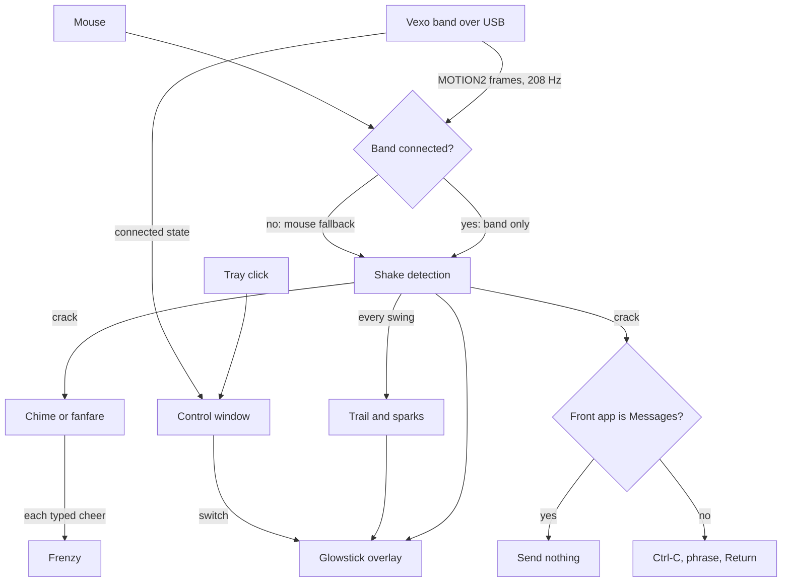

# openCheer


Sometimes claude code is going too shlow, and you must cheer him on.. with glowsticks!

The overlay shows two 3D glow wands, one for each hand, in a first-person view from the bottom of the screen.

## Install + run

```bash
npm install -g opencheer
opencheer
```

windows and mac supported out of the box, but Linux is a special snowflake so you need to install `xdotool` for keyboard automation

```bash
sudo apt install xdotool
```

## Controls

- Click tray icon: open the control window. Use its switch to show or drop the glowsticks and see if the band is connected.
- Cheer him on 🎉
- It sends an interrupt (Ctrl-C) and one of 5 encouraging messages!

## How it works



## Variables

No environment variable is read. Edit the values in the files below.

`overlay.html`, object `P` (px, radians, ms):

| Name | Default | What it does |
|---|---|---|
| `wandLength` | 0.72 | Wand length from the hand to the tip (share of the screen height) |
| `wandWidth` | 0.115 | Grip width at the hand (share of the screen height) |
| `wandTaper` | 0.45 | Tip width divided by grip width at rest; the tip is farther from the viewer |
| `wandInset` | 0.17 | Distance of each hand from its screen edge (share of the screen width) |
| `wandTilt` | 0.13 | Inward tilt at rest (rad) |
| `waveAmp` | 0.2 | Idle wave size (rad) |
| `waveSpeed` | 0.0022 | Idle wave speed (rad/ms) |
| `leanByMouseX` | 0.012 | Lean per px of mouse speed (rad) |
| `leanClamp` | 0.7 | Maximum mouse lean (rad) |
| `leanSmooth` | 0.15 | Mouse lean smoothing |
| `bandLeanAxis` | `'ax'` | Band axis that points sideways while the hand holds a stick; its share of gravity is the lean. Use `'ay'` or `'az'` for a band worn another way |
| `bandRollSign` | 1 | Set -1 to mirror the lean |
| `bandGyroSign` | 1 | Set -1 if the sticks first move the wrong way on a turn; 0 uses the accelerometer only |
| `bandRollClamp` | 1.2 | Maximum band lean (rad) |
| `bandPitchSign` | 1 | `-1` if the sticks swing back when the hand swings forward |
| `bandPitchReturnMs` | 250 | Forward/back swing decays to upright with this time constant (ms) |
| `bandPitchClamp` | 1.2 | Maximum forward/back swing (rad) |
| `bandGravityTau` | 0.04 | How fast the accelerometer corrects the gyro (s) |
| `bandAccelTrust` | 0.15 | The accelerometer corrects only while it reads within this of 1 g (g) |
| `bandHoldDps` | 200 | Wrist gyro speed above which the lean holds still, so a shake does not swing the sticks (deg/s) |
| `bandSmoothMs` | 30 | Display smoothing between band frames (ms) |
| `bandWaveAmp` | 0.04 | Idle wave size while the band is live (rad) |
| `bandShakeDps` | 600 | Wrist gyro speed that starts a shake (deg/s, all three axes together) |
| `bandShakeEndDps` | 250 | A shake ends when the gyro stays below this (deg/s) |
| `bandShakeQuietMs` | 120 | Time below `bandShakeEndDps` before the next shake can start (ms) |
| `bandLiveMs` | 3000 | Band is live while its last sample is younger than this (ms) |
| `cheerPumpPx` | 40 | A cheer pushes the sticks up along their axis by this much (px) |
| `crackSpeed` | 60 | Mouse speed that counts as a crack (px/frame) |
| `crackCooldownMs` | 200 | Minimum time between cracks (ms) |
| `cheerCooldownMs` | 3000 | After a typed cheer, no further cheer is typed for this long (ms); only the chime and the pump react (swing trail and sparks always do). A continuous shake types one cheer per this interval |
| `firstCrackGraceMs` | 350 | No crack for this long after the sticks appear (ms) |
| `fallMs` | 600 | Drop animation time (ms) |
| `frenzyMs` | 4000 | Frenzy length (ms); every typed cheer starts it |
| `auraScale` | 8 | Wand aura radius at rest, in tube half-widths |
| `auraAlpha` | 0.45 | Aura strength at rest |
| `motes` | 10 | Drifting light motes per wand |
| `moteSpeed` | 0.00007 | Mote rise speed (share of the tube per ms) |
| `edgeBase` | 0.25 | Screen-edge glow at rest, as a share of the frenzy level |
| `swingDps` | 300 | Wrist gyro speed that counts as one swing stroke (deg/s); each forward or back stroke gives trail and sparks |
| `swingEndDps` | 120 | A stroke ends below this (deg/s) |
| `swingFullDps` | 1000 | Gyro speed that gives full-size swing feedback (deg/s) |
| `swingMousePx` | 30 | Mouse px/frame that counts as a swing stroke (no band) |
| `swingSparks` | 40 | Sparks per wand in the burst of a full swing |
| `sparkMax` | 160 | Most sparks alive at once |
| `trailMs` | 250 | Swing trail fade time constant (ms) |
| `trailFan` | 8 | Ghost copies in the swing trail |
| `trailStep` | 0.035 | Angle between ghost copies at full energy (rad) |

Sound: the chime, swoosh and fanfare notes are fixed in `overlay.html` (functions `playChime`, `playSwoosh`, `playFanfare`); they have no settings.

`band.js`:

| Name | Default | What it does |
|---|---|---|
| `MOTION2_HZ` | 208 | Band motion sample rate, set with `MOTION2_SET` on each connect; not stored on the band (Hz) |
| `SILENT_MS` | 3000 | No MOTION2 frame for this long: not connected, the stream is started again (ms) |
| `RETRY_MS` | 3000 | Wait between searches for the port (ms) |
| `tickMs` (`REAL_IO`) | 1000 | Check interval (ms) |
| USB product name | `Vexo Open band` | Port match in `findPort` (macOS `ioreg`; device `/dev/cu.usbmodem*`) |

`main.js`:

| Name | Default | What it does |
|---|---|---|
| `phrases` (in `sendMacro`) | 6 cheers, e.g. "You got this!" | Texts typed on a cheer; one is chosen at random |
| `delayMs` (`refocusPreviousApp`) | 80 | Wait before focus returns to the previous app (ms) |
| Macro delay (`sendMacroMacUnchecked`) | 300 | macOS: wait between Ctrl-C and the typed phrase (ms) |
| Skipped app (`ifNotMessages`) | `Messages` | macOS: no cheer is sent when this app is in front |

## Roadmap

- [x] Initial release! 🥳
- [x] Cease and desist letter from Anthropic
